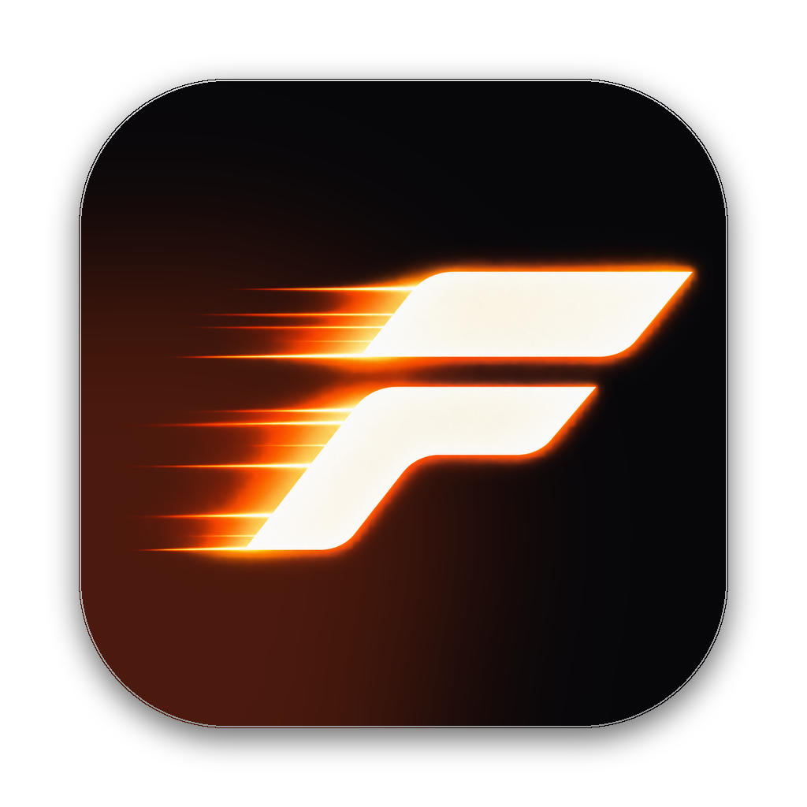

<p align="center"></p>

# FinalMotion

An AI video editor for Mac. Bring your own Claude Code or Codex: it edits a real timeline, and you can edit the same timeline by hand. Motion graphics, captions, clips from long videos. Everything runs locally; there are no credits.

**FinalMotion 1.0 is the final release.** It was a side project. It's free and it works, but it won't get updates.

## Download

[**FinalMotion-1.0.0-arm64.dmg**](https://github.com/Tejashmakwana/finalmotion-releases/releases/download/v1.0.0/FinalMotion-1.0.0-arm64.dmg) · [all releases](https://github.com/Tejashmakwana/finalmotion-releases/releases) · [finalmotion.video](https://finalmotion.video)

## How to open it

The app isn't notarized by Apple, so macOS blocks the first open. You do this once:

1. Open the downloaded file and drag **FinalMotion** into **Applications**.
2. Open FinalMotion. macOS says it can't verify the app. Click **Done**.
3. Open **System Settings → Privacy & Security**, scroll down, and click **Open Anyway** next to FinalMotion. Confirm with your password.

## You'll also need

- An Apple silicon Mac (M1 or newer) on macOS 13 or later.
- Claude Code or Codex, installed and signed in:
  - Claude Code: `curl -fsSL https://claude.ai/install.sh | bash`, then run `claude` once to sign in.
  - Codex: `brew install --cask codex`
- Optional, for transcripts and captions: `brew install whisper-cpp` (needs [Homebrew](https://brew.sh)).

ffmpeg is bundled. Settings → System in the app lists anything that's missing and the command that fixes it.

## Checksum

```
SHA-256  9cd415ef09a08f4330703c4c113c71c9f6b971126c5b54ed69b8df19d53a03e2  FinalMotion-1.0.0-arm64.dmg
```
